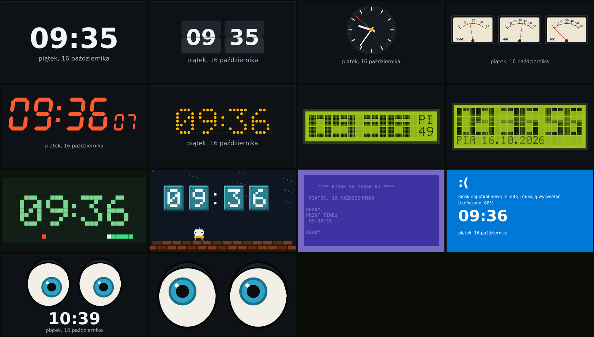
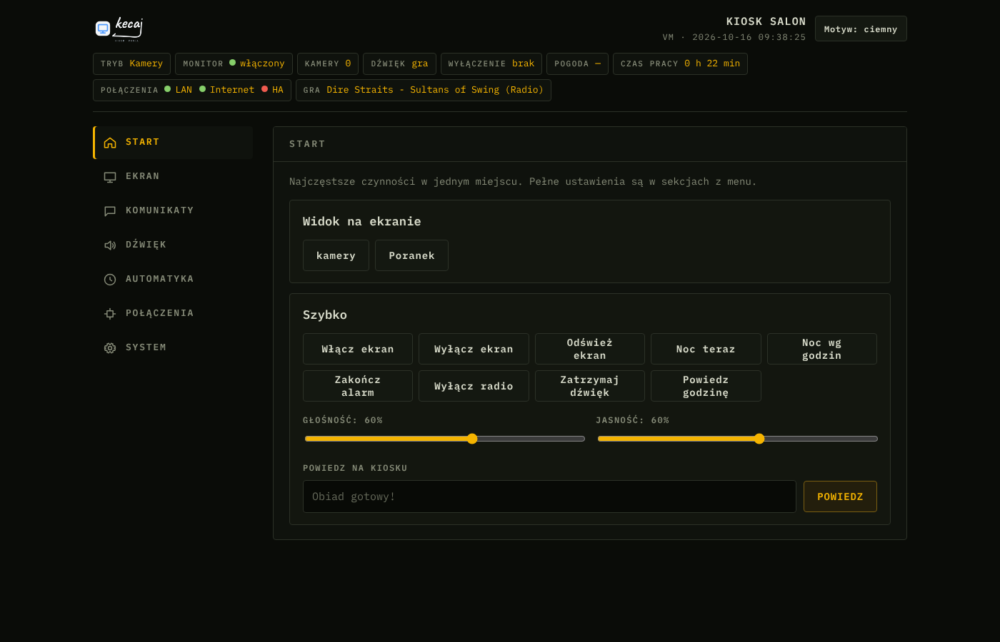
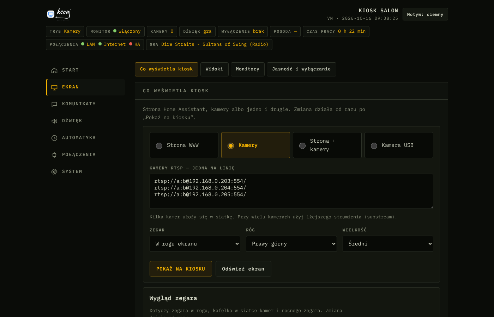
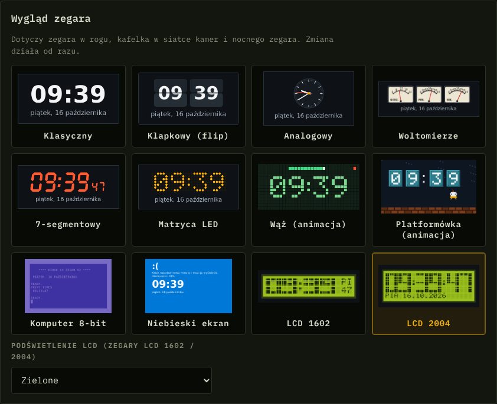
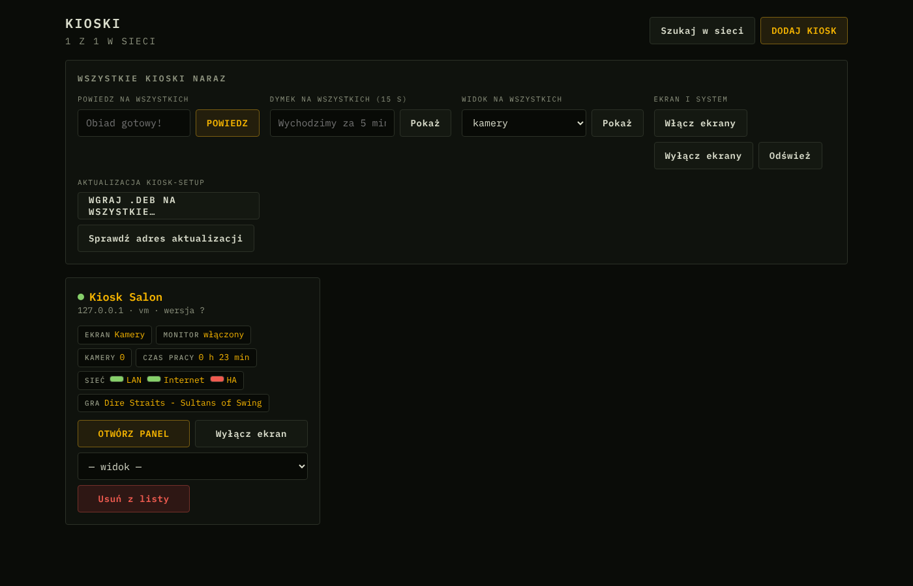

# Kiosk

Ubuntu Server jako kiosk z ekranem dla Home Assistant: Chromium na pełnym ekranie, kamery RTSP,
zegary (flip, analogowy, woltomierz, 7-segmentowy, LCD 1602/2004, C64, BSOD, wąż, platformówka),
karta „teraz gra”, komunikaty głosowe, lokalne rozpoznawanie twarzy na kamerach, MQTT z auto-wykryciem w HA, panel WWW, dysk tylko do odczytu
oraz dodatek Home Assistant „Kioski” do zarządzania wieloma kioskami.



## Zrzuty ekranu

Więcej obrazów: [docs/ZRZUTY.md](docs/ZRZUTY.md).

| Panel WWW — Pilot | Ekran — co wyświetla kiosk |
|---|---|
|  |  |
| **Wygląd zegara** | **Dodatek Home Assistant „Kioski”** |
|  |  |

| Katalog | Zawartość |
|---|---|
| `kiosk-setup/src/` | wszystkie programy instalowane na kiosku (bash / Python) |
| `kiosk-setup/debian/` | pliki pakietu: control, config, templates, postinst (szablon), postrm |
| `kiosk-setup/rootfs/` | pliki statyczne: dokumentacja, logo, czcionki IBM Plex Mono (licencja OFL) |
| `kiosk_manager/` | dodatek Home Assistant „Kioski” |
| `kiosk-android/` | aplikacja Kiosk na Androida (panel, przyciski głośności telefonu) |

Dokumentacja całości (instalacja, ekran, zegary, dźwięk, automatyka, HA, MQTT/API, bezpieczeństwo, diagnostyka, pliki): [docs/DOKUMENTACJA.md](docs/DOKUMENTACJA.md).
Dokumentacja pakietu: [kiosk-setup/rootfs/usr/share/doc/kiosk-setup/README.md](kiosk-setup/rootfs/usr/share/doc/kiosk-setup/README.md)

## Instalacja na kiosku

Gotowy pakiet: [`releases/kiosk-setup_1.0.25_amd64.deb`](releases/).

```bash
sudo apt install ./kiosk-setup_1.0.25_amd64.deb
# aktualizacja istniejącego kiosku (działa też przy dysku tylko do odczytu):
sudo kiosk-update file ./kiosk-setup_1.0.25_amd64.deb
```

### Wersja light

`releases/kiosk-setup-light_1.0.25_amd64.deb` (ok. 0,3 MB) — ekran (Chromium, kamery RTSP), zegary, panel WWW,
MQTT/Home Assistant i muzyka, bez mowy, interkomu i asystenta głosowego. Instalacja jak wyżej; zastępuje
pełny pakiet i odwrotnie. Aktualizacje: `update-light.json` zamiast `update.json`. Budowanie: `./build.sh --light`.
Przełączanie edycji: **System → Aktualizacje → „Przełącz na wersję light/pełną”** albo `sudo kiosk-update switch light|full`.

### Automatyczne aktualizacje z GitHuba

W panelu kiosku: **System → Aktualizacje → „Użyj GitHub”**, potem **Zapisz** i opcjonalnie
„Aktualizuj automatycznie w nocy”. Adres:

    https://raw.githubusercontent.com/kecajtop/Kiosk/main/update.json

Można też jednym przyciskiem: **Aktualizuj z GitHuba (wydanie)** albo **Aktualizuj z gita (najnowszy kod)** —
kiosk pobiera kod z gałęzi `main`, sam buduje pakiet i go instaluje (`sudo kiosk-update github` / `sudo kiosk-update git`).

Kiosk co noc czyta `update.json` i pobiera pakiet tylko wtedy, gdy jest nowsza wersja; potem sprawdza
jego sumę SHA-256. 
**Nowe wydanie:**
1. Zmień `Version:` w `kiosk-setup/debian/control` i uruchom `./build.sh`.
2. Skopiuj pakiet do `releases/` i usuń poprzedni.
3. W `update.json` wpisz `version`, `url`, `sha256` (`sha256sum`) i `size`.
4. Zrób commit i push na `main`.

## Aplikacja na Androida

[`releases/kiosk-android-1.5.apk`](releases/) — panel kiosku na telefonie: fizyczne przyciski głośności
sterują głośnością kiosku, wyszukiwanie kiosków w sieci, zapamiętany token, HTTPS kiosku.
Kod i budowanie (bez Gradle): [`kiosk-android/`](kiosk-android/README.md).

## Dodatek Home Assistant

W Home Assistant: **Ustawienia → Dodatki → Sklep z dodatkami → ⋮ → Repozytoria**, a potem dodaj
`https://github.com/kecajtop/Kiosk` i zainstaluj „Kioski”.

## Budowanie ze źródeł

Potrzebne `dpkg-deb` i `python3`.

```bash
cd kiosk-setup
./build.sh --piper-from kiosk-setup_1.0.25_amd64.deb   # Piper (TTS) z gotowego pakietu
./build.sh --no-piper                                 # albo bez Pipera
# wynik: kiosk-setup/dist/kiosk-setup_<wersja>_amd64.deb
```

Binaria Piper (~50 MB) nie są trzymane w repozytorium. Można je też położyć w `kiosk-setup/piper/`
albo wskazać zmienną `PIPER_DIR`.

**Zmiany w kodzie:**
- Programy edytuje się w `kiosk-setup/src/`. `build.sh` wkleja je do `postinst` według `src/MANIFEST`.
- Panel WWW (HTML, CSS, JavaScript) jest wbudowany w `src/kiosk-api`.
- Wersję pakietu zmienia się w `debian/control`, a wersję dodatku w `kiosk_manager/config.yaml`.
